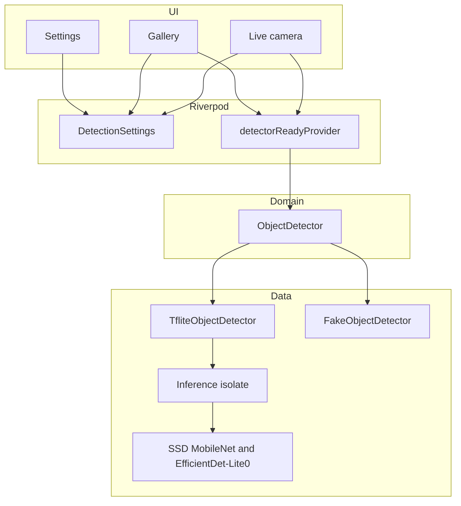

# On-Device Vision

Portfolio demo for **Arpan Bom** ([applycoding](https://github.com/applycoding)), a senior Flutter and mobile engineer. The app runs COCO object detection on device with TensorFlow Lite. Nothing is uploaded.

This is a portfolio demo, not a production product. It shows a camera overlay, a gallery path, a settings screen, and a detector interface with a real TFLite implementation and a fake used by tests.

## What it does

- Live camera preview with bounding boxes, inference time, and frames per second.
- Inference on a background isolate, so the UI isolate keeps painting.
- Gallery mode for a photo you pick. The photo is decoded off the UI isolate.
- Settings for the confidence threshold and the model (SSD MobileNet V1 or EfficientDet-Lite0).
- Android and iOS project files. CI builds a debug Android APK. iOS is configured (camera and photo permissions, deployment target 15) and is meant to be run from a Mac.

## Screens

Screenshots are not checked in. Drop device captures in `docs/screenshots/` if you add them later.

| Screen | What you should see |
| --- | --- |
| Live | Full-screen camera, accent boxes, a HUD with milliseconds, fps, and the model name. |
| Gallery | A picked photo with the same boxes, or a short note when nothing clears the threshold. |
| Settings | Confidence slider and two model cards. |

## Run it

Flutter 3.47.7 (stable) or a newer 3.47 stable.

```bash
bash tool/download_models.sh
flutter pub get
flutter run
```

The script downloads about 7 MB of weights into `assets/models/`. Those files are gitignored. Without them the app still builds, and the live and gallery screens explain that the weights are missing.

| Model | File | Input | Notes |
| --- | --- | --- | --- |
| SSD MobileNet V1 | `ssd_mobilenet_v1_coco.tflite` | 300, uint8 | Quantized COCO SSD from the 2018 TFLite model zoo. Class ids are offset by 1 into the 91-row label map. |
| EfficientDet-Lite0 | `efficientdet_lite0.tflite` | 320 | TFLite Task Library COCO model. Class ids index the 80 COCO labels directly. |

Both heads emit boxes as ymin, xmin, ymax, xmax, then classes, scores, and a count.

## Architecture

The UI talks to an `ObjectDetector`. `main.dart` overrides that provider with `TfliteObjectDetector`. Tests override it with `FakeObjectDetector`, so `flutter test` does not load the native TFLite library.



A camera frame is copied into a `DetectionFrame` on the UI isolate, then sent to a long-lived worker. The worker resizes with nearest-neighbor sampling, runs the interpreter, and returns boxes. Frames that arrive while a run is in flight are dropped.

Gallery bytes are decoded with `compute`, capped at a 1280 px long edge, then sent through the same detector.

## Performance notes

These are planning numbers for this class of model, not a benchmark captured on a device in CI. CI only analyzes, tests the fake detector, and builds the APK.

- The quantized SSD MobileNet V1 network is often in the 20 to 40 ms range on a recent mid-range phone, before preprocessing. EfficientDet-Lite0 at 320 input is usually a little slower.
- End-to-end inference in this app, including the nearest-neighbor resize on the worker, is typically a few tens of milliseconds on a current phone and slower on older CPUs. The HUD reports the last worker time and how many results completed in the past second.
- The UI isolate does not run the interpreter. It copies the camera planes and paints. Dropping frames keeps the preview at the display rate while detection updates more slowly.
- Input is `ResolutionPreset.medium`. A larger preset costs more in the copy and the resize, not in the fixed model input.
- Float inputs, if a future model uses them, are normalized with mean 127.5 and standard deviation 127.5. The two bundled models are uint8 and skip that step.

## Tests

```bash
flutter analyze
flutter test
```

Unit tests cover the output parser, YUV and BGRA sampling, preview rotation, the settings notifier, image decode, and the fake detector. Widget tests cover the overlay, settings, gallery mode with the fake, and navigation when the camera plugin is absent.

## CI

`.github/workflows/ci.yml` on pull requests and on `main`:

- `dart format --set-exit-if-changed`
- `flutter analyze`
- `flutter test`
- `flutter build apk --debug`, after `tool/download_models.sh`, and uploads the APK

## Layout

```
lib/domain        detector interface, frames, labels, preview mapping
lib/data          TFLite isolate, parser, fake detector, image decode
lib/providers     Riverpod settings and the detector binding
lib/ui            live, gallery, settings
test              unit and widget tests against the fake
tool              model download script
```

## License

The app code is a portfolio sample. The downloaded models keep the licenses of their TensorFlow Lite sources.
